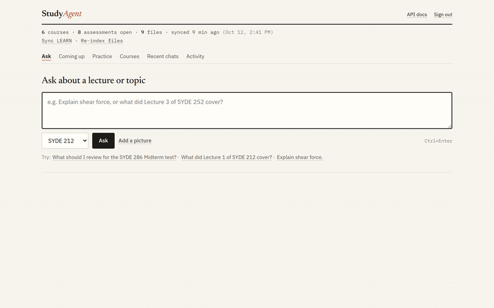
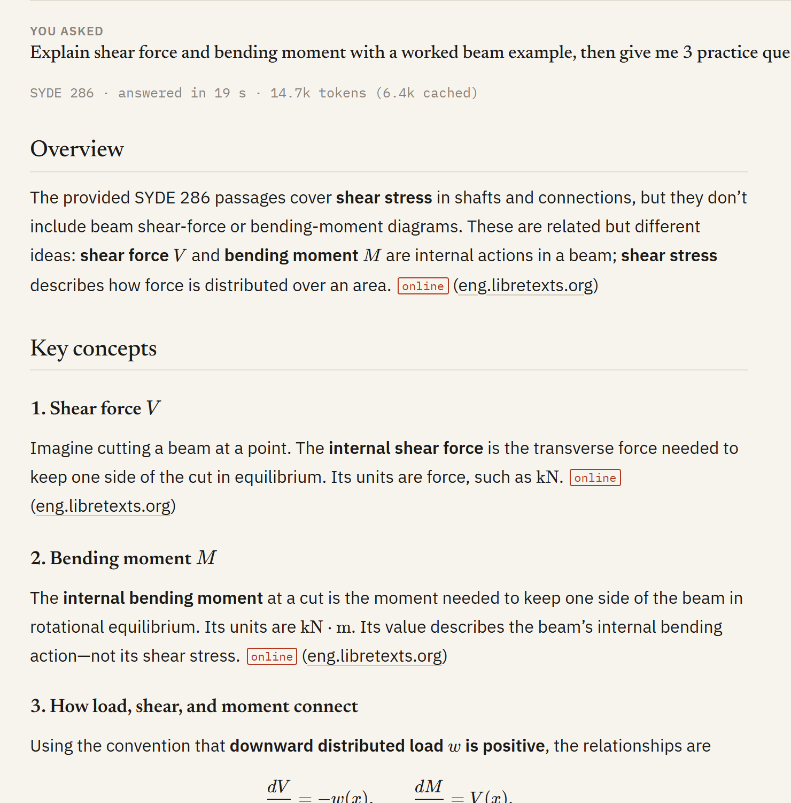
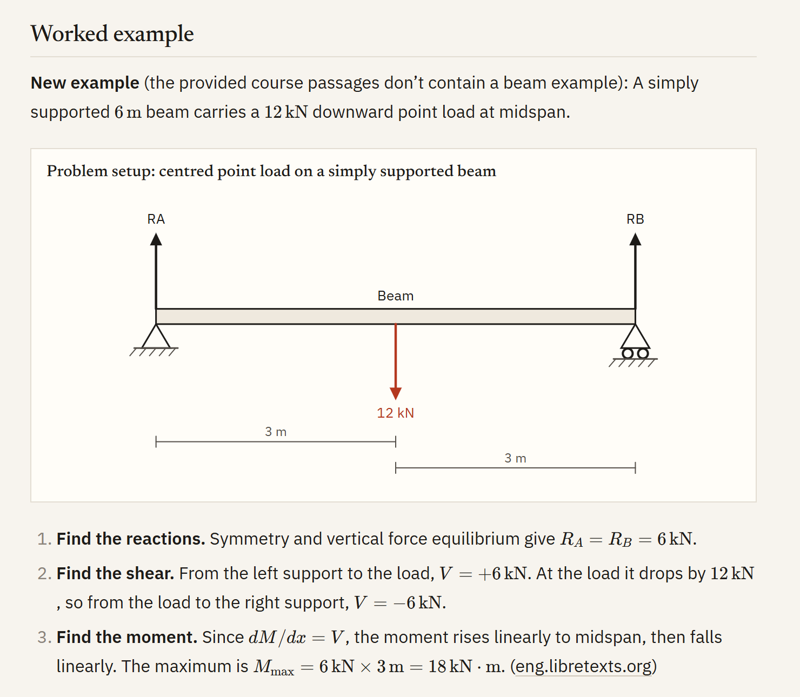
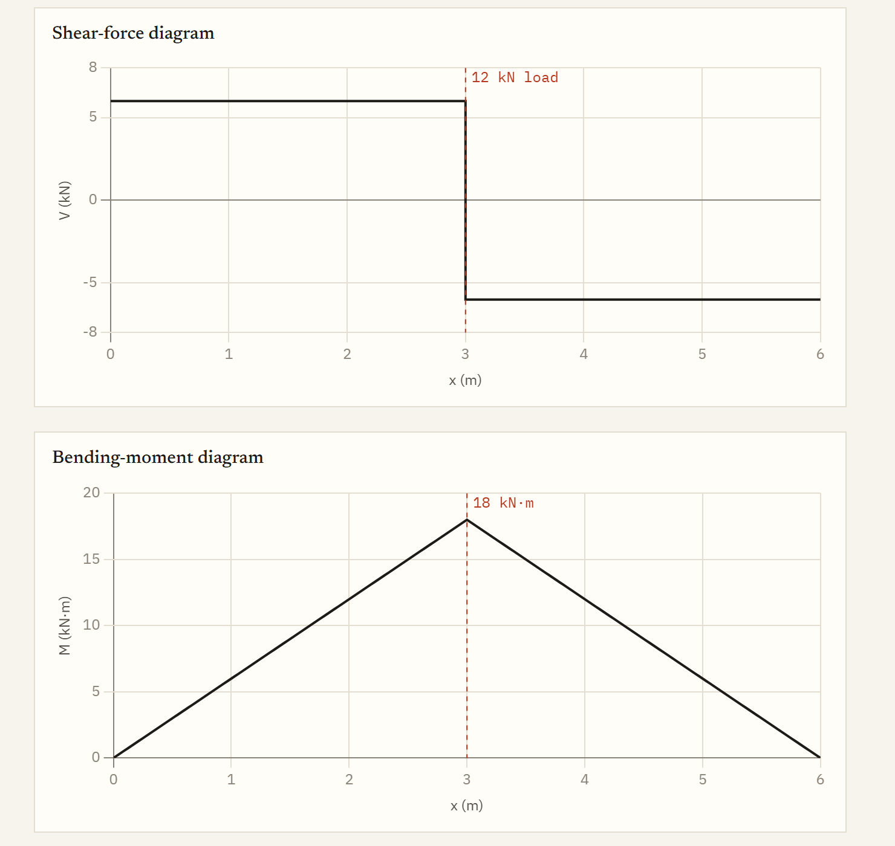
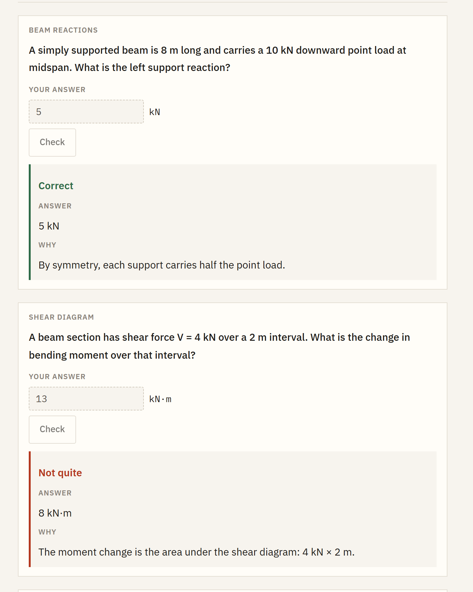
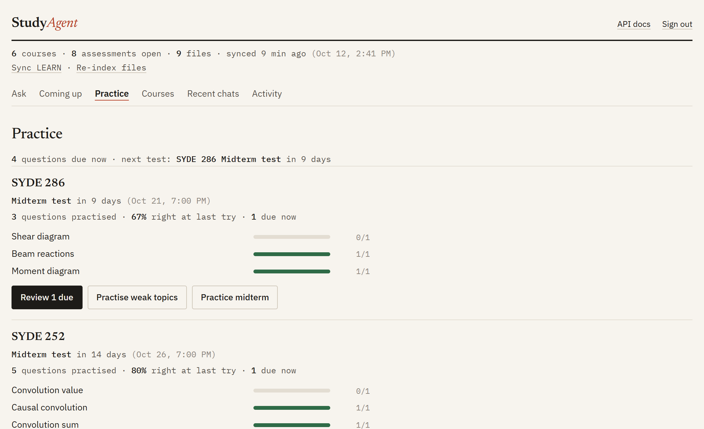
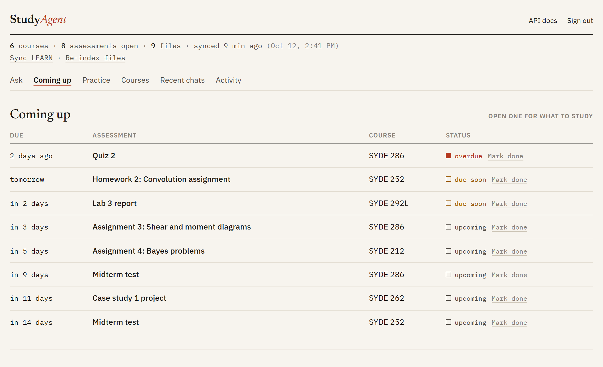
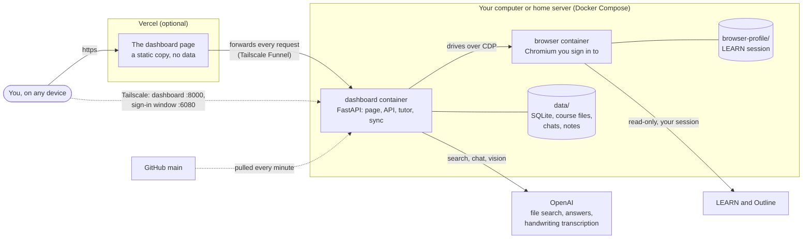

<div align="center">


# StudyAgent

**A tutor that has read your course.**

It reads Waterloo LEARN and Outline through a browser you are signed in to, never changing anything there,<br>
then answers your questions from the files your instructors posted.


[What it does](#what-it-does) · [Try the demo](#try-it-without-learn) · [Architecture](#architecture) · [Setup](#setup) · [Home server](#run-it-on-a-home-server)



<sub>A question, its practice cards, then the Practice and Coming up screens. Recorded in demo mode: the courses and due dates are made up.</sub>

</div>

## What it does

StudyAgent keeps track of your University of Waterloo courses and tutors you from their own materials: active courses, announcements, due dates and every file posted. It runs on one computer, or on an always-on home server that you reach from any device.

<table>
<tr>
<td width="50%" valign="top">

**Answers from your course files**

Every answer cites the file and page it came from, and says so when a point comes from the web instead.



</td>
<td width="50%" valign="top">

**Draws the picture**

Beams, circuits, graphs and concept diagrams are drawn beside the text they explain.



</td>
</tr>
<tr>
<td width="50%" valign="top">

**Graphs the course is taught with**

Shear and moment diagrams, distributions with the tail shaded, signals, cash flows.



</td>
<td width="50%" valign="top">

**Practice marked on the page**

Options and numbers are marked for you, with the answer and the reason.



</td>
</tr>
<tr>
<td width="50%" valign="top">

**Practice that remembers**

Missed questions come back, weak topics are listed first, and a practice midterm is one click.



</td>
<td width="50%" valign="top">

**Everything due, in one list**

Assessments from the LEARN calendar, announcements and each course outline, merged.



</td>
</tr>
</table>

## Architecture



On a single computer there is no Vercel and no browser container: the dashboard runs with `uv`, and the sync attaches to your own Chrome.

### The parts

| Part | Where | What it does |
| --- | --- | --- |
| Dashboard and API | `backend/app/main.py`, `backend/app/web/dashboard.html` | One FastAPI app serves a single-file page and its JSON API: courses, assessments, chat, notes, question screenshots, and the sync and index tasks. With a password set, only the page and `/health` answer before sign-in. |
| Sync | `backend/app/agents/`, `backend/app/browser/`, `backend/app/services/sync_service.py`, `document_collector.py` | Sends small read-only scripts to a browser signed in to LEARN: it lists courses, reads each course's home, calendar, content tree, announcements and Outline, and downloads the files with authenticated GETs. Everything the browser returns is validated with Pydantic before it is saved. |
| Tutor | `backend/app/services/rag.py`, `retrieval.py`, `figures.py`, `question_sources.py`, `pdf_pages.py`, `practice.py`, `chat_images.py` | Searches the course index once, sends the best passages with the question, and checks what comes back: figures are described as data and drawn by the server, a cited course question is found in the saved PDF and shown as a screenshot, and practice questions become cards the page can mark. Attached pictures are checked, read once and kept as text. |
| Background tasks | `backend/app/services/jobs.py`, `refresh.py` | Runs one sync or index at a time for the dashboard's buttons and reports each step. `/health` says when one is running. |
| Practice log | `backend/app/services/practice_log.py` | Keeps every practice answer, schedules each question's next turn, and adds results up by course and topic. |
| Sign-in | `backend/app/services/access.py` | One password and a signed 30-day cookie; no accounts and no session store. |
| Command line | `backend/app/cli/commands.py` | The same sync, index and notes from a terminal, plus setup and diagnostics. |
| Server browser | `browser/` | Chromium on a virtual screen, shown as a web page (noVNC) so you can sign in to LEARN in it, and driven by the sync over its debugging port. |
| Scripts | `scripts/` | `deploy-frontend.sh` puts the page on Vercel; `server-sync.sh` syncs from your own computer and hands the result to the server. |
| Schedules | `n8n/` | Four n8n workflows on the home server: a nightly LEARN sync that pushes when it fails (for example when LEARN signs the server browser out), a 7:30 AM brief of what is due and new, a 7 PM reminder for anything due tomorrow, and a 5 AM check that pushes when something looks misread. They call the API with `AUTOMATION_TOKEN`. |

### What is stored, and where

Everything lives in `data/` beside the code, and nothing but your questions and course text leaves the machine.

| File | Holds |
| --- | --- |
| `study_agent.db` | Courses, assessments (and which you marked done), announcements, the list of files, sync history. |
| `downloads/` | Every course file as downloaded, and beside each PDF its text, page by page. |
| `rag_manifest.json` | Which files are in the OpenAI vector store, so only new or changed ones are uploaded. |
| `chat_sessions.json`, `course_notes.json`, `answer_cache.json` | Your conversations, your notes, and saved answers to repeated questions. |
| `practice.json` | Every practice question you answered, each attempt, and when it is due again. |
| `browser-profile/` (beside `data/`) | The server browser's profile, which is your LEARN session. |

OpenAI holds a copy of the course files' text in a vector store, and sees each question with the passages sent along. The page on Vercel holds no data at all.

### What a question does

1. The page posts the question to `/chat`.
2. The server searches the vector store once, for that course if one is chosen, and keeps the best distinct passages within a token budget.
3. It sends a fixed, cached set of teaching instructions, your notes for the course, the last few exchanges and the passages to the chat model.
4. It validates the answer: figures become drawings, and each course question the tutor cites is located in the saved PDF and turned into a screenshot reference.
5. The answer is saved to the conversation and, for a first question, to the answer cache.

### What a sync does

1. It checks that the browser is on LEARN and signed in; if not, it stops and says so.
2. For each course it reads the pages above, opens each announcement and due-date page, and saves what it finds.
3. It downloads each file. One whose contents have not changed keeps its saved copy and extracted text.
4. From the dashboard, it then uploads new and changed files to the index.

### What is trusted

- **LEARN is only read.** The sync navigates and downloads; it never submits or edits. Your Waterloo password and Duo codes are typed by you into the browser and never pass through the app.
- **The model's output is data.** Figures, citations and source references are parsed and checked; nothing the model writes is run.
- **One password guards a server.** The dashboard will not listen beyond its own computer without one. Automations such as n8n use a separate `AUTOMATION_TOKEN` in an `Authorization: Bearer` header, so they never need the password.
- **The sign-in window is private.** It has no password and is your LEARN session, so it is published on the Tailscale address only.
- **Secrets stay in `.env`**, which is not in git, and logs redact keys, cookies and tokens.

## Prerequisites

- Windows with Google Chrome installed.
- Python 3.12 (or let `uv` provision it).
- [`uv`](https://docs.astral.sh/uv/) for environment and dependency management.
- A Chrome session already signed in to Waterloo LEARN.
- The current Browser Use CLI. Install it into the project-local environment with:

```powershell
uv venv --python 3.12 .browser-use-venv
uv pip install --python .browser-use-venv\Scripts\python.exe "browser-use @ git+https://github.com/browser-use/browser-use.git"
```

Browser Use local mode attaches to the running Chrome session over CDP. It may ask once for remote-debugging permission. The app never asks for or stores a Waterloo password or MFA code. If LEARN shows a sign-in or verification step, complete it yourself in Chrome and rerun the browser test.

## Setup

From the repository root:

```powershell
uv sync --dev
Copy-Item .env.example .env
uv run study-agent setup
```

`OPENAI_API_KEY` is required for RAG indexing and chat. Keep it only in `.env`; it is never printed or sent to the browser.

## Browser connection test

Keep Chrome open and signed in to LEARN, then run:

```powershell
uv run study-agent browser test
uv run study-agent sync
uv run study-agent courses
uv run study-agent assessments
uv run study-agent resources
uv run study-agent submissions
```

`sync` uses the authenticated Chrome session to discover active LEARN course shells, inspect each course, traverse every visible Content module and its discovered Content items, collect PDF/document/slide/page resources, save readable resources locally through authenticated GET requests, capture read-only Dropbox/submission notes from HTML pages, open recent LEARN announcement details, check its Outline page, and persist the extracted records in SQLite. Outline rows without dates (for example, a final listed as `TBD`) are retained as `UNKNOWN`; announced dates are merged with calendar and Outline records when they describe the same assessment. It never clicks Submit or changes LMS data. Authentication remains browser-managed; complete any sign-in or Duo prompt in Chrome.

## Try it without LEARN

Mock mode syncs a made-up copy of the six Fall 2026 courses: dated assignments and tests relative to today, short lecture notes, and announcements. Use it to work on the app without Chrome:

```powershell
$env:BROWSER_MODE = "mock"
uv run study-agent sync
uv run study-agent dashboard
```

Demo data goes to `data/demo.db` and `data/demo-downloads/`, never to your real `data/study_agent.db`, even if `.env` names that database. Remove the variable (`Remove-Item Env:BROWSER_MODE`) to go back to your real courses.

## Course-material chatbot

After a sync, build/update the persistent OpenAI vector store:

```powershell
uv run study-agent rag-index
```

Start the dashboard and ask questions in the “Ask your course materials” box, or call `POST /chat` with `{"question":"Get me up to speed for SYDE 252 tomorrow.","course_code":"SYDE 252"}`. Answers are grounded in your course files and list the files they cite. Re-run `rag-index` after future syncs; unchanged files are skipped.

The index is persistent: each file is uploaded and embedded once, and only new or changed files are processed again. Each question then costs:

- **One search, no repeats.** The app searches the index once, drops duplicate and overlapping passages, keeps at most three per file, and sends the best ones up to `RAG_CONTEXT_TOKENS` (default 3,000). The model never runs its own file searches.
- **Small chunks.** Files are indexed in 400-token chunks overlapping by 100, not OpenAI's default 800/400, so the budget holds more distinct passages.
- **A cached prefix.** The teaching and figure guides are one fixed prompt prefix that OpenAI caches after the first question (cached input is billed at a discount).
- **Nothing for repeats.** A question already asked with the same course, settings and index is answered from `data/answer_cache.json`; the dashboard says "saved answer" and offers "ask fresh".

Each answer shows its token count, e.g. "9.3k tokens (5.7k cached)". For fewer tokens still, lower `RAG_CONTEXT_TOKENS`, or set `RAG_WEB_SEARCH=false` (web search adds a few thousand tokens when the model uses it).

Chat answers use the lighter `OPENAI_CHAT_MODEL` (default `gpt-6-luna`) with low reasoning effort and a 4,500-token output cap; handwritten-PDF transcription keeps `OPENAI_MODEL`. The tutor is built around study techniques with strong evidence:

- **Concept by concept:** "Explain ..." questions get an Overview, one subsection per key concept in the chapter, a Worked example, and Common mistakes.
- **Practice testing:** every explanation ends with "Check yourself" questions you answer on the page before seeing the answer.
- **Spacing:** the Study checklist says when to revisit the topic.
- **No answer-copying:** questions that look like graded assignment or lab problems get concepts and a first-step hint, not a full solution.
- **Any lecture:** naming "Lecture 7", "week 3", "chapter 5" or "tutorial 4" narrows the search to the matching course files.
- **Online context:** web search adds intuition and real-world examples the course files lack. Those sentences are marked "(online)", the sources are linked, and course notation always wins. Set `RAG_WEB_SEARCH=false` to use course files only.

To check that live answers are readable, run the built-in question set: seven SYDE 286 shear-force questions, plus a core topic and a "what did Lecture 1 cover" question for each course. You can also pass your own with `-q`:

```powershell
uv run study-agent rag-eval --rounds 3
uv run study-agent rag-eval -q "Explain bending stress." --course "SYDE 286"
```

Each answer is scored for structure, concept coverage, balanced LaTeX, paragraph and sentence length, cited sources, and (for questions about a shape) whether a figure came back; the full report is written to `data/rag_eval.json`.

### Practice questions you answer

A practice question is a card, not text with the answer underneath. Pick one of the options, or type a number or a sentence, and press Check: the card says whether you were right, shows the answer and explains why. A numeric answer is marked for you, within 2% for rounding, and an exact fraction such as 2/11 can be typed as the fraction or its decimal. An answer in words is shown beside yours to compare.

The tutor writes each question as a short labelled block (the question, lettered options if any, the answer, and why). The server reads it, checks it is a usable question, and works out which option or number is right; a block it cannot read stays in the answer as plain text, so no question is lost.

### Practice that remembers

Every practice question you answer is kept, with whether you got it right, in `data/practice.json`. An option or a number is marked for you; for an answer in words or code you say whether you had it. That record is what the **Practice** screen works from.

- **Missed questions come back.** A question answered wrong is due again at once. One answered right waits a day, then two, four and seven. This is successive relearning, the combination of practice testing and spacing that study research rates highest.
- **Weak topics first.** Each question names the concept it tests, so the screen shows every course's topics with the share you got right at your last try, weakest first.
- **Three ways to practise.** *Review due* asks the questions that are due again, with no model call. *Practise weak topics* asks the tutor for new questions on the topics you miss most. *Practice midterm* asks for 15 questions in the exam's format across everything it covers.
- **The next test.** Each course shows how long until its next midterm, test or exam on LEARN, and the course with the nearest one is listed first.

A turn with several questions shows its score as you go ("6 of 6 answered · 4 right · 67%"). Scores count each question once, by your latest answer: what you know now, not what you once got wrong.

### Code in answers

Code is shown with its language named, a Copy button and syntax colours (highlight.js, loaded only when an answer has code). What the program prints is a separate block marked Output.

### Pictures in questions

Paste a screenshot into the question, drop an image on the box, or use **Add a picture**; up to four go with one question, and a picture on its own is a question. The page shrinks each one before sending it.

The server checks that each is a real image and redraws it from its pixels. A vision model then reads it once: the text, numbers and equations exactly, and a short description of any diagram. The tutor sees the picture and that reading, and the course files are searched by what the picture says, so a screenshot of a problem finds the lecture it belongs to. The conversation keeps a thumbnail and the reading, not the picture, so a follow-up still knows what was in it; click a thumbnail to see what was read.

### Conversations and follow-ups

Every question starts a chat that is saved locally (`data/chat_sessions.json`). Ask a follow-up ("why is that?", "show me an example") and the tutor answers it in context: the last three exchanges go with the question, and a short follow-up is searched together with the question it follows. "Recent chats" in the dashboard reopens any conversation with its answers, figures and sources; "New chat" starts over. The API is `POST /chat` with the returned `session_id`, plus `GET /chat/sessions`, `GET /chat/sessions/{id}` and `DELETE /chat/sessions/{id}`.

### Sources and links

Answers cite course files inline, with the page for PDFs (`[course text.pdf, p. 87]`). Every cited file links to its LEARN page, and the Sources list names it by its LEARN title.

### Course questions, shown from your files

When the tutor gives an example or practice question from your course materials, the answer shows where it is from, right above the question:

- which question ("Problem 2.6 (a)", "Example 4.3", or item 21 of a numbered exercise list),
- which file, by its LEARN name and saved filename, linked to its LEARN page,
- where in it: the printed page and the PDF page when a book numbers them differently ("p. 10 (PDF page 18)"), the slide for a slide deck, and the chapter when the book has a table of contents,
- a screenshot of the question, cut from your saved PDF. A question that runs over a page break gets both parts. Click a screenshot to open the whole page.

The tutor only names the file, page and label; the server does the rest. It accepts only files whose passages were sent with the question, finds the label in the local PDF near the cited page (a label that starts a line at the list's indent, so a later "see Question 21" is not mistaken for it), and reports the page the question is really on. If the label is not on the cited page, the whole page is shown and the answer says so. Files without a PDF (slides saved as `.pptx`, handwritten notes read by vision) get the reference without a screenshot. A question the tutor writes itself is called a new question and gets no screenshot.

Page numbers come from labels in each PDF's extracted text. `rag-index` re-extracts any PDF whose text predates those labels and uploads it again, so run it once after updating. Screenshots are rendered on request by `GET /course-resources/{resource_id}/pages/{page}` (optionally `?top=0.2&bottom=0.6`, fractions of the page height) and nothing is stored.

### Course notes

Some things the instructor says never reach LEARN, or not where sync reads them, such as what a midterm covers. Keep several dated notes per course. In the dashboard, open a course to list, add or delete notes; use **About** to attach one to an assessment. An assessment's panel shows its own notes and has an add box that attaches notes to that assessment automatically.

From the terminal:

```powershell
uv run study-agent course-note "SYDE 212"                          # list notes and IDs
uv run study-agent course-note "SYDE 212" --text "Office hours are Friday."
uv run study-agent course-note "SYDE 212" --text "Chapters 1-4." --about "Midterm"
uv run study-agent course-note "SYDE 212" --file midterm.txt --about "Midterm"
uv run study-agent course-note "SYDE 212" --delete <id>             # delete one note
uv run study-agent course-note "SYDE 212" --clear                   # delete all course notes
```

Use the assessment's title for `--about` to show the note in its panel. Notes are saved locally in `data/course_notes.json`; existing notes from the single-note version are preserved. Each note can contain up to 4,000 characters, with up to 50 notes per course.

The tutor reads notes newest first, labelled with what each is about, within a 4,000-character context limit. It uses them with questions about that course to identify scope and write practice questions in the exam's format (for example multiple choice).

### Files too large to sync

Sync skips LEARN files over 15 MB, such as a whole course textbook. Download the file from LEARN yourself, then attach it to its LEARN item:

```powershell
uv run study-agent import-file "$HOME\Downloads\course-text.pdf" --link "https://learn.uwaterloo.ca/d2l/le/content/1299242/viewContent/6617316/View"
```

This saves it with the item, extracts the PDF text page by page and indexes it. The tutor then searches it and cites it with its LEARN title, link and page numbers. Later syncs keep the imported copy.

### Figures in answers

When a topic has a shape or a picture, the tutor draws it next to the text it explains:

| Figure | Used for | Drawn by |
| --- | --- | --- |
| Graph | functions, distributions, shear and moment diagrams, signals, Bode plots (log axes), economic curves; stems for x[n] and cash flows, bars for histograms and PMFs, shaded tails for tests | Chart.js |
| Free-body diagram | beams with supports and distributed loads, blocks on inclines, particles, disks | the server |
| Circuit | schematics with sources, R, L, C, switches, diodes, meters | schemdraw |
| Concept diagram | processes, cause and effect, proof outlines | Mermaid |
| Sketch | anything else (a molecule, a geometric construction, a timeline) | the model's own SVG |

Some courses are taught with particular graphs, so a question about one also carries a short guide to them (`backend/app/services/course_figures.py`): SYDE 212, and any STAT course, gets distributions with the asked-for area shaded, hypothesis tests with their rejection regions, PMFs as bars and histograms; SYDE 252 gets signal operations, convolution, spectra, Bode plots and pole-zero plots; SYDE 262, and any ECON course, gets cash-flow diagrams, present worth against interest rate with the IRR and MARR marked, break-even and depreciation. Formulas can call the distributions (`normpdf`, `normcdf`, `tpdf`, `chi2pdf`, `binompmf`, `poissonpmf` and more), Lathi's signal shapes (`u`, `rect`, `tri`, `sinc`) and the interest factors (`pf`, `pa`, `ap`, `fa` and the rest), so the tutor never writes a density or factor out by hand (`backend/app/services/plot_functions.py`).

The model only describes a figure as data; nothing it writes is run. The server checks every description with Pydantic. It evaluates formulas with a parser that accepts only arithmetic and math functions, and lays out free-body diagrams and circuits itself. Every SVG is rebuilt from an allow-list of drawing elements, and the browser sanitizes it again. A figure that can't be drawn is left out of the answer, never shown as raw JSON. Chart.js and Mermaid load only when an answer needs them.

## Keep it running in the background

With Chrome open and signed in, run this in a separate PowerShell window:

```powershell
uv run study-agent daemon --interval-minutes 60
```

It performs one full sync immediately and repeats every hour. Leave that window running; press `Ctrl+C` to stop it. Because local Chrome mode uses your existing interactive browser session, Chrome must remain open and signed in for background scans to succeed.

## Dashboard

Start the local read-only dashboard from the repository root:

```powershell
uv run study-agent dashboard
```

It opens <http://127.0.0.1:8000/dashboard> in your browser; press `Ctrl+C` to stop it. Use `--port 8001` if 8000 is taken, or `--no-open` to skip opening the browser. Click a course to see its assessments, collected coursework, announcements, and locally marked completion count. Click an assessment to see ranked relevant coursework and study instructions tailored to quizzes/tests versus assignments/labs/projects. The assessment panel lets you mark work completed or reopen it; this is stored locally and survives future syncs. The JSON API is available at `/api/dashboard`, `/courses/{id}`, `/assessments/{id}`, `/resources`, and `/changes`.

Completion is deliberately explicit: StudyAgent does not claim that an assessment is complete just because you opened a page or viewed a file. Resources are shown as collected coursework; actual assessment completion is marked by you from the dashboard.

`submissions` shows the Dropbox/submission wording captured from readable LEARN Content pages:

```powershell
uv run study-agent submissions
```

## Run it on a home server

The dashboard and tutor can run on an always-on machine with Docker, so they are there from any of your devices. The server can sync LEARN too, with a browser of its own that you sign in to.

On the server, put the code in a folder with a `.env` holding `OPENAI_API_KEY`, the server's Tailscale address as `TAILSCALE_IP` and a `DASHBOARD_PASSWORD` of 12 characters or more. Copy `data/` beside it, create an empty `browser-profile/` folder there, and start it:

```bash
docker compose up -d --build
```

The dashboard is then at `http://<TAILSCALE_IP>:8000/dashboard` for devices signed in to your Tailscale, and `/health` answers for an uptime monitor.

With a password set, the page asks for it once per device and the server answers nothing else until then. The session lasts 30 days, and changing the password signs every device out. Eight wrong passwords pause sign-in for 15 minutes. The dashboard refuses to listen beyond its own computer without a password.

The server's `data/` is the live copy: it holds your chats, your notes, the course files and the assessments you marked done. Stop the dashboard on this computer once the server runs, and add course notes from the dashboard, not with `course-note`.

### Sync LEARN on the server

`compose.yaml` also runs a Chromium for the sync to read LEARN with. Open its window at `http://<TAILSCALE_IP>:6080/vnc.html` from one of your Tailscale devices and sign in to LEARN there, with your password and Duo, as you would in any browser. The session is kept in `browser-profile/` and survives restarts of the browser, until Waterloo asks you to sign in again.

Then use the two buttons under the dashboard's status line. **Sync LEARN** reads your courses again and indexes what is new; **Re-index files** only brings the tutor's index in line with the saved files. They run on the server one at a time. A panel under the buttons lists each step as it happens, with a running clock, then says whether the task completed successfully or failed and what it did. A sync that meets LEARN's sign-in page stops and says so: sign in through the window and sync again.

In its own browser the sync brings each page to the front before reading it, because Outline and a course's home only finish loading in the tab that is showing, and closes its tabs after each course so the browser does not run out of memory.

The sign-in window has no password of its own and whoever opens it is using your LEARN session, so it is published on the Tailscale address only. Never put it behind Funnel or any public address.

You can still sync from this computer instead, with the Chrome you are signed in to: set `STUDY_SERVER=user@host` in this computer's `.env` and run `bash scripts/server-sync.sh` from Git Bash. It stops the server's dashboard, brings its database back, runs `sync` and `rag-index` here, sends the database, the changed course files and the index to the server, and starts the dashboard again. Saved files are found by name in `data/downloads`, so the paths either machine wrote into the database work on the other.

### Deploy on push

Make the server's folder a git clone of this repository and have cron run a small script every minute that fetches `main`, and when it has moved, checks it out, runs `docker compose up -d --build` and waits for `/health`. A commit that fails to build or come up is rolled back to the one before it. While a sync or an index is running, `/health` reports `"busy": true` and the script leaves the project alone until it is done, so a deploy never cuts a task off. Your `.env` and `data/` are untracked, so a deploy never touches them. The page on Vercel is separate: after changing `dashboard.html`, also run `bash scripts/deploy-frontend.sh`.

### Open it from anywhere, with the page on Vercel

To reach it without Tailscale, give the server a public https address and put the page on Vercel:

1. On the server, turn on [Tailscale Funnel](https://tailscale.com/kb/1223/funnel) for the dashboard's port: `sudo tailscale funnel --bg 8000`. The first run links to the Tailscale admin page that enables Funnel and HTTPS for your tailnet. It prints the address, `https://<server>.<tailnet>.ts.net`.
2. On this computer, set `STUDY_API_URL` in `.env` to that address and run `bash scripts/deploy-frontend.sh` from Git Bash, signed in to the Vercel CLI.

Vercel then serves only the page, which holds no data, and forwards everything the page loads to the server, which checks the password itself. The page tries again when a request is lost on the way: always for something it only reads, and for anything else only when Vercel says the request never reached the server. Vercel gives up on a forwarded request after 120 seconds, so an unusually slow answer shows an error there even though it is saved; reload and it is in Recent chats.

## Daily workflow

From the repository root, keep Chrome open with LEARN and Outline signed in:

```powershell
uv run study-agent browser test
uv run study-agent sync
uv run study-agent rag-index
uv run study-agent courses
uv run study-agent assessments
```

`browser test` verifies the connection. `sync` rescans all six enrolled Fall 2026 SYDE courses and checks each course's Outline page on every run. `courses` confirms the active course list, `assessments` shows upcoming work from LEARN, announcement details, and Outline rows (including undated `UNKNOWN` rows), and `resources` lists the collected study material.

If Waterloo asks for a password or Duo verification, complete it in Chrome, then rerun `browser test` and `sync`. The application does not store Waterloo credentials, MFA codes, or browser cookies.

Use the underlying diagnostic when needed:

```powershell
browser-use --doctor
```

## Tests and checks

```powershell
uv run ruff format .
uv run ruff check .
uv run mypy backend
uv run pytest
```

## Current scope

Built and in use:

- Reading LEARN and Outline without changing them: courses, assessments from the calendar, announcements and outlines, and every posted file.
- A tutor grounded in those files, with page citations, screenshots of cited course questions, figures, practice questions marked on the page, formatted code, pictures in questions, conversations, course notes and saved answers.
- A dashboard with assessments, completion you mark yourself, notes, and buttons that sync and re-index with live progress.
- Practice that is recorded and spaced: missed questions return, weak topics are listed first, and a practice midterm is one click.
- Running on a home server in Docker with a browser of its own, a password, a public address through Tailscale Funnel with the page on Vercel, and deploys on push.

Not built yet:

- Noticing what changed between syncs. The Activity screen and `/changes` exist, but nothing writes to them.
- Skipping the download of files LEARN says have not changed; every file is fetched on every sync, which is most of a sync's time.
- Syncing on a schedule from the server, and telling you when LEARN needs a new sign-in.
- Topic extraction and study planning.
